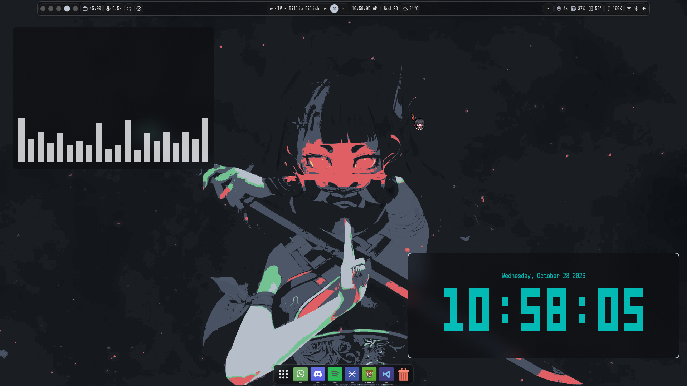
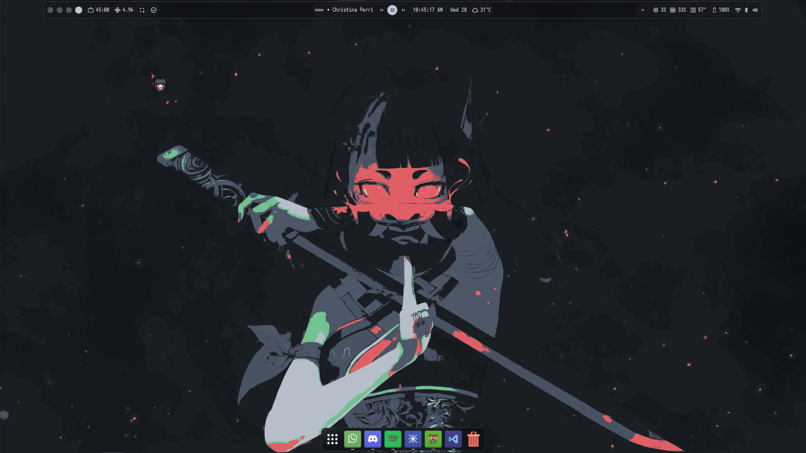
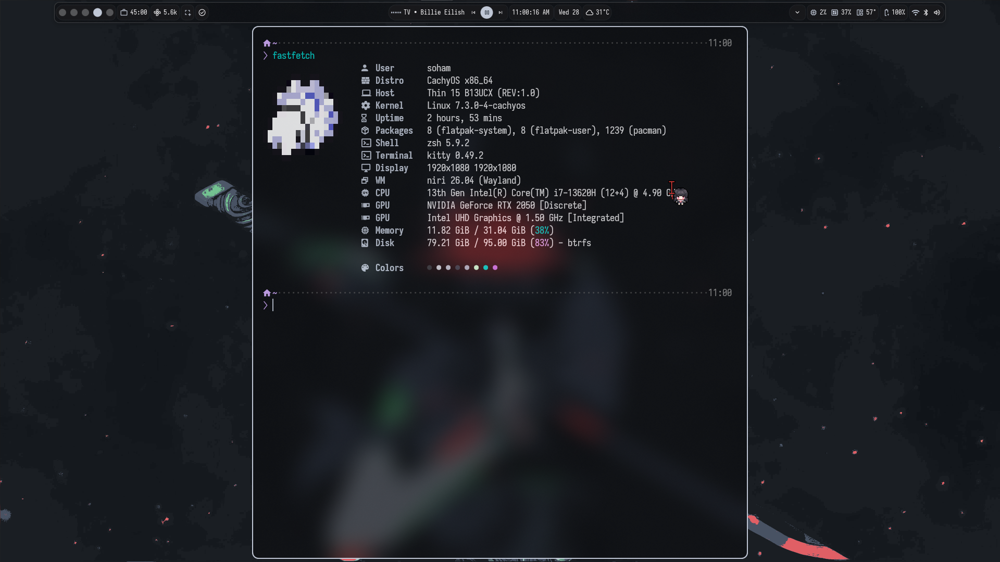
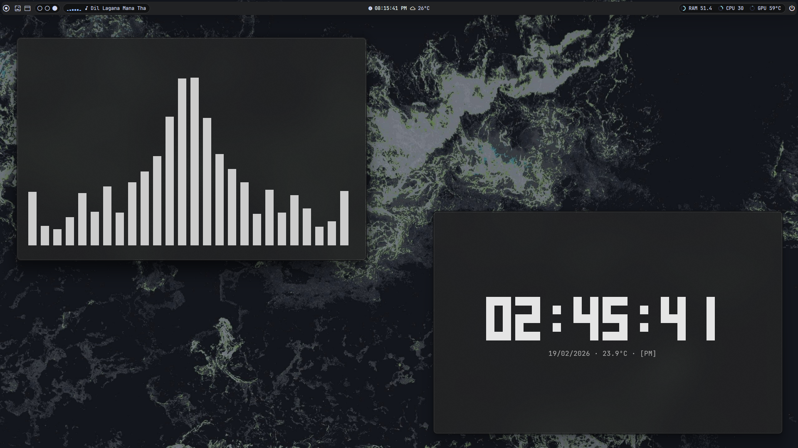
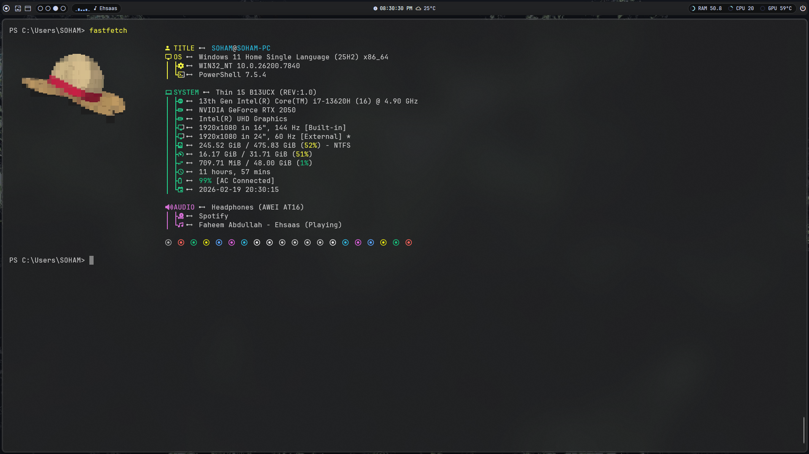

<h1 align="center">My Linux + Windows Setup</h1>

<div align="center">
  
</div>

<div align="center">
  
  
</div>

<div align="center">
  
  
</div>

<p align="center">
CachyOS with niri and DankMaterialShell on one side of the boot menu, Windows 11 with Komorebi and YASB on the other.<br/>
Linux gets symlinked by one script, Windows gets copied by hand.
</p>

---

## Stack

| Piece | Linux | Windows |
|:--|:--|:--|
| Compositor | [niri](https://github.com/YaLTeR/niri) | [Komorebi](https://github.com/LGUG2Z/komorebi) + [WHKD](https://github.com/LGUG2Z/whkd) |
| Desktop shell | DankMaterialShell | [YASB](https://github.com/amnweb/yasb) |
| Taskbar mods | - | [Windhawk](https://windhawk.net/) |
| Terminal | [kitty](https://github.com/kovidgoyal/kitty) | [Windows Terminal](https://github.com/microsoft/terminal) |
| Shell | zsh + [Powerlevel10k](https://github.com/romkatv/powerlevel10k) | zsh in [WSL](https://learn.microsoft.com/windows/wsl/) (Debian) |
| Editor | [Neovim](https://github.com/neovim/neovim) + [LazyVim](https://www.lazyvim.org/), Zed, VS Code | Zed, VS Code |
| Widgets | [Conky](https://github.com/brndnmtthws/conky), btop | [Rainmeter](https://www.rainmeter.net/) |
| Visualizer | [cava](https://github.com/karlstav/cava) | cava |
| Fetch | [fastfetch](https://github.com/fastfetch-cli/fastfetch) | fastfetch |

## Palette

| Name | Choice |
|:--|:--|
| Theme | matugen palette built from the current wallpaper |
| Font | ZedMono Nerd Font |
| Icons | Numix-Square |
| Cursors | WCursor packs (Camellya, Chisa) |
| Wallpapers | [SpreadSheets600/Wallpapers](https://github.com/SpreadSheets600/Wallpapers) |

---

## Install

```bash
git clone --recurse-submodules https://github.com/SpreadSheets600/Dotfiles.git ~/Dotfiles
cd ~/Dotfiles
./install.sh --dry-run   # show the links
./install.sh             # back up conflicts, then symlink
chsh -s /usr/bin/zsh     # if zsh is not your login shell yet
```

> [!NOTE]
> These are my personal settings, published as a backup and for reference. Read
> `install.sh` before running it and expect to change keybinds, paths and
> hardware bits. Existing files are moved to
> `~/.local/state/dotfiles-backups/<timestamp>/` first, nothing is deleted.

### Packages

```bash
sudo pacman -S --needed zsh zsh-completions zsh-autosuggestions \
  zsh-syntax-highlighting zsh-history-substring-search zsh-theme-powerlevel10k \
  kitty eza bat fd ripgrep fzf zoxide vivid yazi lazygit btop fastfetch direnv \
  git-delta duf dust procs glow tealdeer pkgfile zellij neovim nodejs npm \
  tree-sitter-cli stylua shfmt jq discord spotify-launcher paru \
  ttf-zed-mono-nerd ttf-iosevka-nerd ttf-jetbrains-mono-nerd \
  ttf-nerd-fonts-symbols-mono

paru -S pokeget fzf-tab numix-square-icon-theme-git numix-icon-theme-git
```

---

## Linux

niri tiles the windows, DankMaterialShell draws the bar, dock, widgets and lock
screen, and matugen recolours Neovim, kitty, GTK, Discord and niri from the
current wallpaper. The editor hot-reloads the generated palette, so a wallpaper
change re-themes the whole desktop without a restart.

Helpers live in `linux/scripts/` and land in `~/.local/bin`:

| Script | What it does |
|:--|:--|
| `webapp.sh` | any site in a browser app window, plus a menu entry |
| `dotfiles-sync.sh` | commit and push this repo to GitHub |
| `game-launch.sh` | gamescope + gamemode + MangoHud wrapper |
| `phone-cam.sh` | Android phone as a virtual camera |
| `pokemon-logo.sh` | random Pokémon sprite for fastfetch |

Keybinds: `linux/.config/niri/dms/binds.kdl` and `linux/.config/niri/custom/`.
Validate the config with `niri validate -c ~/.config/niri/config.kdl`.

---

## Windows

Komorebi tiles, YASB replaces the taskbar, Windhawk restyles it, and Rainmeter
draws the clock and cava. WSL runs Debian with the same zsh setup as the Linux
side.

| Repo path | Target |
|:--|:--|
| `windows/terminal/settings.json` | Windows Terminal `settings.json` |
| `windows/komorebi/` | `%USERPROFILE%\.config\komorebi` |
| `windows/yasb/` | `%USERPROFILE%\.config\yasb` |
| `windows/windhawk/` | paste into the Windhawk UI |
| `windows/rainmeter/` | import the `.rmskin` |
| `windows/wsl/` | `wsl.conf` inside WSL, `wsl.config` as `%USERPROFILE%\.wslconfig` |

> [!NOTE]
> Windhawk mods are stored per mod in `windows/windhawk/*.json`. Paste them into
> the mod's advanced settings and hit save. Full target paths are in
> [`SYSTEM.md` §10](SYSTEM.md#10-windows--shared-files).

---

## Layout

| Path | What is in it |
|:--|:--|
| [`linux/`](linux/) | CachyOS configs: niri, DankMaterialShell (DMS), kitty, nvim, zsh, fastfetch, cava, conky |
| [`linux/scripts/`](linux/scripts/) | helpers installed to `~/.local/bin`, plus `wsl/` extras |
| [`windows/`](windows/) | Komorebi, YASB, Windhawk, Windows Terminal, Rainmeter, WSL |
| [`shared/`](shared/) | VS Code, Zed and Discord configs used on both platforms |
| [`wallpapers/`](wallpapers/) | submodule with the wallpaper collection |
| [`SYSTEM.md`](SYSTEM.md) | the long version: packages, keybinds, troubleshooting |

---

## Wallpapers

[**SpreadSheets600/Wallpapers**](https://github.com/SpreadSheets600/Wallpapers)
is mounted at `wallpapers/` and `~/Pictures/Wallpapers` points straight at
`wallpapers/Wallpapers/`, one flat folder of images, so any picker can use the
collection. Every push rebuilds a gallery at
[spreadsheets600.github.io/Wallpapers](https://spreadsheets600.github.io/Wallpapers/).

```bash
cd ~/Dotfiles/wallpapers
python3 scripts/organize.py       # HEIC -> JPEG, renumber loose files
python3 scripts/build_site.py     # thumbnails + site -> _site/
```

---

## Sync

`dotfiles-sync.sh` commits and pushes the paths in `linux/scripts/dotfiles-sync.paths`.
It stages only what rebuilds the Linux setup, refuses secrets and files over
95 MB, rebases if the remote moved, and pushes the wallpaper submodule before
recording its new commit here.

```bash
dotfiles-sync.sh list       # what gets committed
dotfiles-sync.sh status     # pending changes + ahead/behind
dotfiles-sync.sh run        # commit + push now
dotfiles-sync.sh --dry-run  # preview
```

---

## Thanks

Structure ideas from [mathiasbynens/dotfiles](https://github.com/mathiasbynens/dotfiles),
[caarlos0/dotfiles](https://github.com/caarlos0/dotfiles),
[driesvints/dotfiles](https://github.com/driesvints/dotfiles) and the
[dotfiles.github.io](https://dotfiles.github.io/) index.

Fonts: [ZedMono](https://github.com/zed-industries/zed-fonts),
[Iosevka](https://github.com/be5invis/Iosevka),
[JetBrains Mono](https://www.jetbrains.com/lp/mono/). Icons:
[Numix-Square](https://github.com/numixproject/numix-icon-theme-square).
