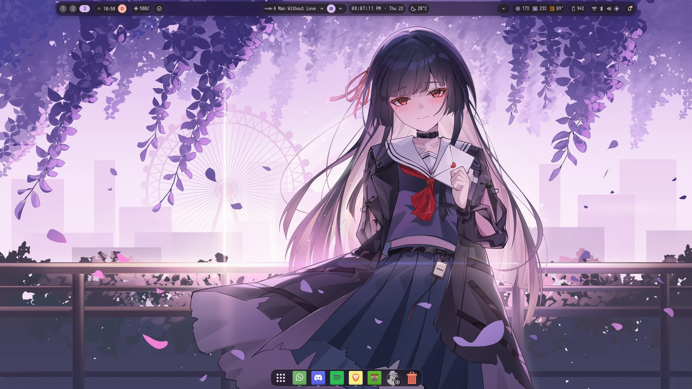

# dotfiles

My daily driver: **CachyOS** with **niri** + **DankMaterialShell** on Linux,
**Windows 11** on the other side of the boot menu. Linux configs are symlinked
into `$HOME` by one script; Windows configs are copied by hand. If it is worth
tweaking, it is in here.

| Linux — niri + DankMaterialShell | Windows — Komorebi + YASB + Rainmeter |
|:---:|:---:|
|  |  |

```bash
git clone --recurse-submodules https://github.com/SpreadSheets600/Dotfiles.git ~/Dotfiles
cd ~/Dotfiles && ./install.sh
```

> These are my personal settings, published as a backup and for reference.
> Read what `install.sh` does before running it, and expect to change keybinds,
> paths and hardware-specific bits. Nothing is deleted: conflicts are moved to
> `~/.local/state/dotfiles-backups/<timestamp>/` first.

## contents

| path | what is in it |
|---|---|
| [`linux/`](linux/) | CachyOS configs: niri, DMS, kitty, nvim, zsh, fastfetch, cava, conky … |
| [`linux/scripts/`](linux/scripts/) | helpers installed to `~/.local/bin` (`webapp.sh`, `dms-theme-refresh.sh`, sync scripts) |
| [`linux/snapshots/`](linux/snapshots/) | live configs that cannot be symlinked, copied by the sync |
| [`windows/`](windows/) | Komorebi, YASB, Windhawk, Windows Terminal, Rainmeter, WSL |
| [`shared/`](shared/) | VS Code, Zed and Discord configs used on both platforms |
| [`wallpapers/`](wallpapers/) | submodule → [SpreadSheets600/Wallpapers](https://github.com/SpreadSheets600/Wallpapers) |
| [`SYSTEM.md`](SYSTEM.md) | the long version: setup steps, keybinds, packages, troubleshooting |

## install

```bash
git clone --recurse-submodules https://github.com/SpreadSheets600/Dotfiles.git ~/Dotfiles
cd ~/Dotfiles

./install.sh --dry-run   # show what would be linked
./install.sh             # back up conflicts, then symlink
chsh -s /usr/bin/zsh     # if zsh is not already your login shell
exec zsh -l
```

The installer links `linux/` into `~/.config` and `$HOME`, installs the helper
scripts, recreates `~/Pictures/Wallpapers`, initialises the wallpaper submodule
and enables the 15-minute sync timer.

Already cloned without submodules?

```bash
git submodule update --init --recursive
```

### packages

```bash
sudo pacman -S --needed zsh zsh-completions zsh-autosuggestions \
  zsh-syntax-highlighting zsh-history-substring-search zsh-theme-powerlevel10k \
  kitty bat eza fzf fd ripgrep zoxide vivid yazi direnv stow lazygit btop \
  fastfetch cava neovim nodejs npm tree-sitter-cli stylua shfmt jq \
  discord spotify-launcher zellij git-delta duf dust procs glow pkgfile \
  ttf-zed-mono-nerd ttf-iosevka-nerd ttf-jetbrains-mono-nerd \
  ttf-nerd-fonts-symbols-mono

sudo pacman -S --needed paru
paru -S fzf-tab numix-square-icon-theme-git   # AUR
```

## the setup

| area | linux | windows |
|---|---|---|
| compositor | niri | Komorebi + WHKD |
| bar | DankMaterialShell | YASB |
| terminal | kitty | Windows Terminal |
| shell | zsh + Powerlevel10k | — |
| editor | Neovim (LazyVim), Zed, VS Code | Zed, VS Code |
| taskbar | — | Windhawk |
| widgets | btop, Conky | Rainmeter |
| fonts | ZedMono Nerd Font | — |
| icons | Numix-Square | — |
| cursors | WCursor (Camellya / Chisa) | Windows cursor |
| theme | DMS matugen | custom |

**One palette everywhere.** DankMaterialShell generates a matugen palette from
the current wallpaper and writes it into Neovim (`colors/dms.lua` + lualine),
kitty, GTK, Discord CSS and niri. Neovim hot-reloads the generated files, so
the editor follows the wallpaper without a restart. `dms-theme-refresh.sh`
forces a full regeneration after installing a themed app.

**Shell.** No plugin manager, no network calls at startup. Powerlevel10k with a
two-line prompt, `eza`, `bat`, `fd`, `ripgrep`, `fzf-tab`, `zoxide`, `yazi`,
`lazygit`, `direnv`, `vivid`, `git-delta`, shared 100k history, and `fastfetch`
with a random Pokémon sprite (`NOFETCH=1` to skip).

**Editor.** LazyVim with Python, TypeScript, JSON, YAML, TOML, Markdown, Docker
and Git extras. Mason installs LSPs, formatters and linters on demand;
Treesitter uses the system CLI. Only the config is tracked — plugins live in
`~/.local/share/nvim`.

**Web apps.** `webapp.sh <url> [name]` opens any site in a Brave window with no
tabs or address bar and adds a menu entry. `--isolated` gives it its own
profile; `--list` and `--remove` manage existing ones.

## windows

| piece | screenshot |
|---|---|
| YASB bar, Rainmeter widgets, dual monitor |  |

Copy the files to their targets — full table in
[`SYSTEM.md` §10](SYSTEM.md#10-windows--shared-files):

```text
windows/terminal/settings.json      Windows Terminal
windows/komorebi/                   %USERPROFILE%\.config\komorebi
windows/yasb/                       %USERPROFILE%\.config\yasb
windows/windhawk/                   paste into the Windhawk UI
windows/rainmeter/                  import the .rmskin
windows/wsl/wsl.conf                /etc/wsl.conf
windows/scripts/system-cleanup.ps1  run as Administrator
```

## wallpapers

[**SpreadSheets600/Wallpapers**](https://github.com/SpreadSheets600/Wallpapers)
is mounted at `wallpapers/` and `~/Pictures/Wallpapers` points straight at
`wallpapers/Wallpapers/`, one flat folder of images, so any picker can use the
collection. The repo also builds a thumbnail gallery automatically on every
push.

```bash
cd ~/Dotfiles/wallpapers
python3 scripts/organize.py       # HEIC -> JPEG, renumber loose files
python3 scripts/build_site.py     # thumbnails + site -> _site/
```

## sync

`dotfiles-sync.sh` commits and pushes the setup to GitHub every 15 minutes.
It stages only the paths in `linux/scripts/dotfiles-sync.paths`, refuses staged
secrets and files over 95 MB, rebases if the remote moved, and pushes the
wallpaper submodule before recording its new commit here.

```bash
dotfiles-sync.sh list       # what gets committed
dotfiles-sync.sh status     # pending changes + ahead/behind
dotfiles-sync.sh run        # commit + push now
dotfiles-sync.sh --dry-run  # preview
```

## notes

- Cursors: `wcursor current` shows the active theme; DMS owns the choice and a
  systemd path unit mirrors it to GTK, X11, GSettings and niri.
- Fonts and icons are re-applied by `install.sh` through `gsettings`.
- Git identity, aliases and `gh` setup: [`SYSTEM.md` §8](SYSTEM.md#8-git-github-cli-and-identity).
- Neovim plugin updates: `nvim --headless "+Lazy! sync" +qa`.

## thanks

Ideas and structure borrowed from
[mathiasbynens/dotfiles](https://github.com/mathiasbynens/dotfiles),
[caarlos0/dotfiles](https://github.com/caarlos0/dotfiles),
[driesvints/dotfiles](https://github.com/driesvints/dotfiles) and the
[dotfiles.github.io](https://dotfiles.github.io/) index.

Fonts: [ZedMono](https://github.com/zed-industries/zed-fonts),
[Iosevka](https://github.com/be5invis/Iosevka),
[JetBrains Mono](https://www.jetbrains.com/lp/mono/) ·
Icons: [Numix-Square](https://github.com/numixproject/numix-icon-theme-square).
